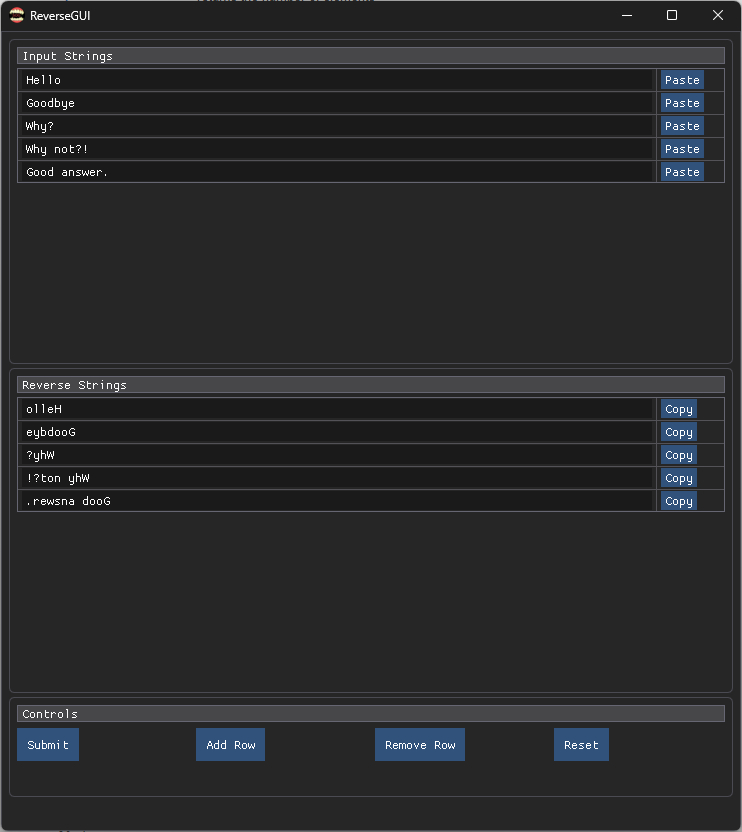

About
-----
**A silly tool for reversing strings.**

- Made with Raylib (raysan5).
- rlImGui (raylib-extras)
- With SDL3 as a backend (libsdl-org).
- Design made with ImGui (ocornut).

Updates
--------
- v2.0.0 released
- Raylib updates have allowed for seemless SDL3 integration with no library changes.
- Also, ImGui integration with rlImGui.
- Hell Yes.
- Total Refactor.

## As-Is No Warranties

Current Progress
-----------------


TODO
-----
- Tweak UI
- Add more keyboard shortcuts
- Make graphical cut and past buttons like v1.0.0

VENDOR LIBRARY CHANGES
---------------
- None at the moment.
- 3rd party libraries seem to be mingling nicely.

BUILDING
--------
Building should be as simple as using two cmake commands:
```shell
cmake -B build
cmake --build build --config [Debug | Release]
```

INSTALLATION
------------
Binaries get copied into "install" at the project root.
```shell
cmake --install build
```

LICENSE
-------
- Raylib is released under zlib license.
- SDL is released under zlib license.
- ImGui is released under MIT license.

```
My personal code for this project is public domain (not that it'll be useful anyways).
No fees
No limitations
No warranties
No attribution necessary 
```
